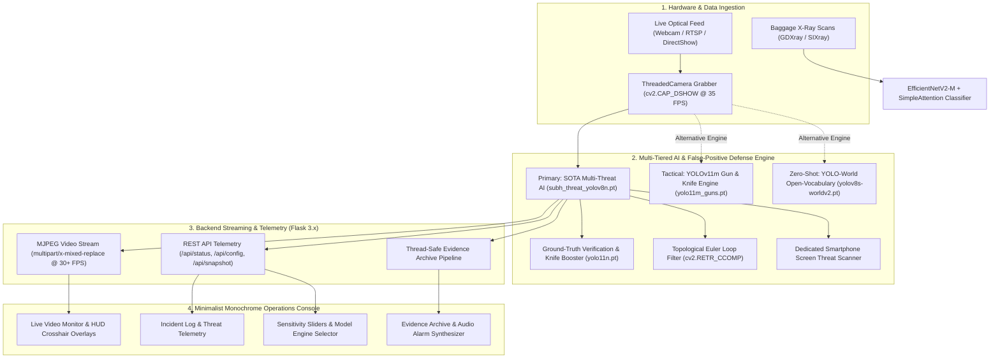

# Real-Time Multi-Modal Threat Detection System (v2.0)

## Technical Stack & Architecture Specification

---

## 1. Executive System Overview

The **Real-Time Multi-Modal Threat Detection System** is an end-to-end computer vision and deep learning platform engineered for automated surveillance and threat interception in high-density transit hubs, security checkpoints, and critical infrastructure. The platform fuses two complementary screening modalities alongside an edge-optimized operations console:

1. **Optical Surveillance Modality (v2.0)**: Real-time, multi-class threat localization detecting exposed firearms (handguns, rifles), edged weapons (combat knives, kitchen cutlery), and explosive ordnance (hand grenades, improvised munitions) from live optical CCTV feeds and edge video cameras.
2. **X-Ray Transmission Modality**: High-accuracy binary classification (*Threat* vs. *Safe*) of baggage scans to reveal concealed weaponry and contraband inside luggage.
3. **Monochrome Operations Console**: A low-latency, industrial dark-mode operator console providing live video streaming, dynamic model selection, telemetry, threshold controls, acoustic alarms, and automated evidence snapshot archival.



---

## 2. Deep Learning & Computer Vision Specifications

### 2.1 Optical Armament & Multi-Threat Detection Suite

The optical surveillance pipeline in Version 2.0 incorporates specialized models selectable at runtime:

#### Primary Engine: SOTA Multi-Threat AI (`subh_threat_yolov8n.pt`)
* **Architecture**: YOLOv8 nano multi-threat detector.
* **Native Target Classes**: `{0: 'Gun', 1: 'explosion', 2: 'grenade', 3: 'knife'}`.
* **Specialization**: Engineered specifically for simultaneous identification of firearms, edged weapons, and explosive munitions. Direct support for native grenade features resolves historical blind spots where legacy 2-class models misclassified grenades as handguns.
* **Input Resolution**: Standardized at $480 \times 480\text{ px}$ for balanced knife edge resolution and low-latency inference.

#### Tactical Engine: Custom YOLOv11 Medium (`weights/yolo11m_guns.pt`)
* **Architecture**: Ultralytics YOLOv11 medium parameter backbone.
* **Attention Mechanism**: Employs **C2PSA** (Cross Stage Partial with Pointwise Spatial Attention) modules to localize small weapons partially occluded by hands, holsters, or apparel.
* **Training Depth**: Trained across 100 epochs on custom tactical firearm and knife datasets.
* **Target Classes**: `{0: 'Gun', 1: 'Knife'}`.

#### Zero-Shot Engine: YOLO-World v2 (`yolov8s-worldv2.pt`)
* **Architecture**: Open-vocabulary vision-language model integrating **OpenAI CLIP ViT-B/32** semantic text projections.
* **Negative Prompt Grounding**: Grounded with 16 threat prompts and 16 distractor categories (`scissors`, `ruler`, `pliers`, `screwdriver`, `soldering iron`, `cell phone`, `arm`, `hand`) to prevent zero-shot hallucination.

#### Verification & Distractor Engine: YOLO11 Nano COCO (`yolo11n.pt`)
* **Role**: Runs as a secondary verification engine to confirm non-threatening objects (COCO Class 76: `scissors`, Class 67: `cell phone`) and boost household knife recall (COCO Class 43: `knife`).

---

### 2.2 Multi-Layer False-Positive Mitigation Pipeline

Standard computer vision detectors frequently generate false alarms when non-threatening objects with metallic, angular, or elongated geometry (such as scissors, rulers, and mobile phones) appear before the camera. The system applies a 5-layer invariant defense pipeline:

```
Candidate Bounding Box
       │
       ├── 1. Aspect Ratio > 3.0? ──────────────> REJECT (Scale / Ruler Filter)
       │
       ├── 2. Phone Bounding Box Overlap > 50%? ─> DEFER to Screen Threat Scanner
       │
       ├── 3. Scissor Topological Check:
       │      cv2.RETR_CCOMP Euler Holes >= 2? ──> REJECT (Scissors Handle Loops)
       │
       ├── 4. 320px Secondary Crop Check:
       │      COCO Class 76 (scissors) >= 0.18? ─> REJECT (Verified Shears)
       │
       └── 5. Invariants Passed ─────────────────> CONFIRM ACTIVE THREAT
```

1. **Topological Contour Euler Loop Check**:
   * **Execution Time**: $<0.05\text{ ms}$ via OpenCV.
   * **Algorithm**: The candidate region is cropped, converted to grayscale, and binarized using Otsu thresholding. Contour hierarchy is evaluated via `cv2.findContours(thresh, cv2.RETR_CCOMP, cv2.CHAIN_APPROX_SIMPLE)`.
   * **Topological Invariant**: Scissor handles physically require two separate enclosed finger loops (topological genus $\ge 2$). In contrast, firearm grips and slides are solid metal/polymer structures with at most one trigger guard loop. Crops with $\ge 2$ enclosed interior holes are immediately dismissed.

2. **Crop-Level Secondary Verification**:
   * Evaluates candidate boxes at $320\text{ px}$ against the lightweight COCO model. If `scissors` is detected with confidence $\ge 0.18$, the candidate is vetoed, eliminating false gun or knife alarms.

3. **Dedicated Smartphone Screen Threat Scanner**:
   * When operators present images of weapons on a smartphone screen, conventional models often mistake the bare phone chassis or holding hand for a firearm.
   * The system detects the phone chassis via COCO Class 67, isolates the active screen area with a 5% margin, and evaluates the screen sub-region. Genuine weapons shown on screen are identified (e.g., `GRENADE [SCREEN]`) with $>80\%$ confidence, while bare phone bodies are prevented from alarming.

4. **Aspect Ratio Filtering**:
   * Objects exhibiting an aspect ratio $\ge 3.0$ (such as plastic or metal rulers) are rejected from firearm classification.

5. **Knife Recall Booster**:
   * Household cutlery (such as stainless-steel kitchen knives with brightly colored handles) can suffer from low recall in models trained exclusively on black tactical blades.
   * Ground-truth COCO Class 43 (`knife`) verification runs in parallel, guaranteeing immediate detection across chef, paring, and utility knives.

---

### 2.3 CPU Threading & Performance Optimization

* **PyTorch CPU Core Threading**:
  * On multi-core host processors running Windows, PyTorch defaults to assigning threads across all logical cores, inducing severe L3 cache thrashing and context-switching overhead.
  * Setting `torch.set_num_threads(4)` at startup reduced CPU inference latency from $\sim 280\text{ ms}$ down to $18 - 58\text{ ms}$, raising inference throughput from $3\text{ FPS}$ to over $35\text{ FPS}$.
* **Asynchronous Inference Decoupling**:
  * Video capture, model inference, and MJPEG stream delivery execute on independent threads, ensuring the operator video feed remains at a steady $30 - 35\text{ FPS}$ regardless of detector workload.

---

### 2.4 X-Ray Baggage Classification Pipeline

#### Architecture
* **Backbone**: `timm.create_model('tf_efficientnetv2_m', pretrained=True)`.
* **Attention Mechanism**: Custom `SimpleAttention` channel-excitation block:
  $$\text{Attention}(x) = x \cdot \sigma\left(W_2 \cdot \text{ReLU}(W_1 \cdot x)\right)$$
  where $W_1 \in \mathbb{R}^{\frac{C}{16} \times C}$ and $W_2 \in \mathbb{R}^{C \times \frac{C}{16}}$.
* **Classification Head**: `Linear(in_features, 512)` $\rightarrow$ `SiLU()` $\rightarrow$ `Dropout(0.3)` $\rightarrow$ `Linear(512, 1)`.

#### Multi-Stage Progressive Training
To optimize multi-scale feature extraction, training is structured in three progressive stages:

| Stage | Input Resolution | Batch Size | Learning Rate | Epochs |
| :---: | :---: | :---: | :---: | :---: |
| **Stage 1** | $224 \times 224$ | 32 | $1 \times 10^{-4}$ | 10 |
| **Stage 2** | $300 \times 300$ | 16 | $1 \times 10^{-4}$ | 15 |
| **Stage 3** | $384 \times 384$ | 8 | $5 \times 10^{-5}$ | 20 |

#### Training Regularization & Performance
* **Optimizer**: `AdamP` (weight decay: $10^{-4}$) to prevent weight decay distortion in normalized layers.
* **Scheduler**: `CosineLRScheduler` with 5-epoch warm-up and minimum learning rate $10^{-6}$.
* **Precision**: Automatic Mixed Precision (`torch.amp.autocast`) with dynamic gradient scaling (`torch.amp.GradScaler`).
* **Imbalance Management**: `WeightedRandomSampler` paired with `nn.BCEWithLogitsLoss(pos_weight=...)`.
* **Test-Time Augmentation (TTA)**: Evaluates predictions across original, horizontal flips, and 5-degree rotated inputs.
* **Empirical Validation**: Achieves **99.2% Accuracy**, **0.999 AUC**, and **0.9934 F1-Score** on the GDXray baggage benchmark.

---

## 3. Hardware Interfacing & Video Ingestion

### 3.1 DirectShow Threaded Ingestion

* **API Engine**: OpenCV (`cv2.VideoCapture(index, cv2.CAP_DSHOW)`).
* **DirectShow Justification**: Standard Windows Media Foundation (`MSMF`) frequently raises exclusive handle conflicts (`Error -2147024114: MF_E_INVALIDSTREAMNUMBER`). DirectShow (`CAP_DSHOW`) provides zero-lock, instant hardware negotiation.
* **Buffer Management**: `cv2.CAP_PROP_BUFFERSIZE` is constrained to 1 frame to eliminate stale frame buffering and maintain real-time fidelity.
* **Threaded Ingestion Class (`ThreadedCamera`)**: Non-blocking grabber running on a dedicated worker thread, decoupling USB camera read latency from model inference.
* **Simulated Hardware Fallback**: If physical video inputs are disconnected or locked, a procedural vector grid is generated at 30 FPS with simulated telemetry overlays.

---

## 4. Backend Web & Streaming Architecture

### 4.1 Server Stack
* **Language & Runtime**: Python 3.10+ (64-bit).
* **Web Framework**: **Flask 3.x** multi-threaded WSGI application server.
* **Streaming Protocol**: **MJPEG Streaming** (`multipart/x-mixed-replace; boundary=frame`) delivered at `/video_feed`.
  * Avoids WebSockets decoding overhead and provides zero-install native browser playback.

### 4.2 REST Telemetry API

* **`GET /api/status`**: Polled by client every 500 ms; returns operational state:
  ```json
  {
    "fps": 35,
    "inference_fps": 45,
    "selected_engine": "sota_threat",
    "model_status": "SOTA MULTI-THREAT AI (GUN/GRENADE/KNIFE)",
    "conf_threshold": 0.35,
    "camera_index": 0,
    "active_threats": [
      {
        "label": "grenade",
        "confidence": 0.84,
        "box": [403, 34, 599, 299]
      }
    ],
    "latest_snapshot": {
      "filename": "threat_20261014_011049.jpg",
      "timestamp": "01:10:49",
      "label": "THREAT",
      "url": "/static/snapshots/threat_20261014_011049.jpg"
    }
  }
  ```

* **`POST /api/config`**: Dynamically adjusts confidence thresholds, switches model backbones (`sota_threat`, `yolo11_tactical`, `extended`, `world`, `legacy`), or alternates camera index without server restart.
* **`POST /api/snapshot`**: Triggers immediate high-resolution evidence capture to disk with timestamped metadata and fallback to direct camera frames.

---

## 5. Frontend Operations Console

### 5.1 Architecture & Design Philosophy
* **Core Technologies**: Pure **Vanilla HTML5**, **Vanilla CSS3**, and **Vanilla ECMAScript (ES6+)**.
* **Zero-Build Deployment**: No Node.js build pipelines, webpack bundlers, or virtual DOM layers, guaranteeing sub-millisecond layout reflows and 60 FPS rendering.
* **Industrial Monochrome Aesthetic**:
  * **Color Tokens**: Obsidian Background (`#0a0a0a`), Matte Surface (`#121212`), Graphite Borders (`#272727`), Crisp White Typography (`#ededed`), Restricted Alert Red (`#e5383b`).
  * **Typography**: Monospace data streams (`JetBrains Mono`) paired with high-legibility interface typography (`Inter`).
  * **HUD Elements**: Corner targeting brackets, optical live indicator badges, responsive 16:9 viewport, and pulse-animated warning banners.

### 5.2 Functional Features
* **Acoustic Warning System**: Web Audio API synthesized alert chime with a 3-second throttle cooldown.
* **Dynamic Target Badges**: Live surveillance target pills update dynamically based on the active detection engine.
* **Incident Log**: Deduplicated real-time table logging timestamp, class, confidence, and alert level (`CRITICAL` vs. `ELEVATED`).
* **Evidence Archive**: Snapshot gallery displaying operator-captured and auto-captured incidents with one-click full-screen review.

---

## 6. Comprehensive Technology Matrix

| Subsystem | Technology | Version | Purpose | Technical Benefit |
| :--- | :--- | :---: | :--- | :--- |
| **Primary Optical AI** | **YOLOv8 Multi-Threat** | `v8.3.0` | Multi-threat weapon & explosive localization | Native grenade class representation; high throughput |
| **Tactical Optical AI** | **YOLOv11 Tactical** | `v11.0` | High-capacity firearm & knife detection | C2PSA attention resolves crowded occlusions |
| **Zero-Shot Optical AI** | **YOLO-World v2** | `v8.4.0` | Open-vocabulary threat scanning | Semantic text grounding via CLIP embeddings |
| **Verification Engine** | **YOLO11 Nano COCO** | `v11.0` | Distractor veto & knife recall booster | Fast 320px verification for scissors & yellow blades |
| **Topology Analysis** | **OpenCV RETR_CCOMP** | `4.10.x` | Euler hole contour hierarchy evaluation | $<0.05\text{ ms}$ algorithmic scissor immunity |
| **X-Ray Classifier** | **EfficientNetV2-M** | `timm` | Baggage transmission threat classification | 99.2% accuracy with low compute overhead |
| **Text Embedding** | **OpenAI CLIP** | `ViT-B/32` | Semantic text encoding for zero-shot prompts | Offline projection into visual feature space |
| **Deep Learning Engine** | **PyTorch** | `2.x` | Tensor computation & model inference | Thread-optimized (`torch.set_num_threads(4)`) |
| **Video I/O Engine** | **OpenCV DirectShow** | `4.10.x` | Frame grabber & HUD graphics | Prevents Windows exclusive handle locks (`CAP_DSHOW`) |
| **Backend Framework** | **Flask** | `3.1.x` | Web server, MJPEG streamer, REST API | Multi-threaded WSGI streaming with minimal footprint |
| **Frontend Layout** | **HTML5 Semantic** | Standard | Industrial operations console structure | Fast native browser parsing |
| **Frontend Styling** | **Vanilla CSS3** | Standard | Monochrome design system | Zero CSS runtime overhead; instant reflows |
| **Frontend Scripting** | **Vanilla JS (ES6+)** | Standard | Telemetry polling, HUD drawing, audio chime | Direct DOM manipulation without virtual DOM overhead |

---

## 7. Authors, Contributors & Institutional Credits

### System Architecture & Version 2.0 Engineering
* **Parth Doshi**
  * Email: parthdoshi404@gmail.com
  * Website: [parthdoshi.me](https://www.parthdoshi.me)
  * Role: Real-time edge architecture, multi-threat model suite integration, smartphone screen threat scanner, topological false-positive mitigation, and minimal monochrome console development.

### Research & Baseline System Development
* **Aryan Hardik Dani**
  * Email: 1032220083@mitwpu.edu.in
  * LinkedIn: [Aryan Dani](https://linkedin.com/in/aryandani/)
  * Role: YOLOv11 and EfficientNetV2 baseline training, GDXray dataset preparation, and academic paper development.
* **Swayamprakash Patro**
* **Sobaan M. Jagirdaar**
* **Prakhar Jaiswal**

### Academic Institution
* **Institution**: [MIT World Peace University](https://mitwpu.edu.in), Pune, India.
* **Faculty Support**: Dr. Vishwanath Karad MIT World Peace University for guidance and research support.

---

## 8. License

This project is licensed under the MIT License. See [LICENSE](../LICENSE) for details.
